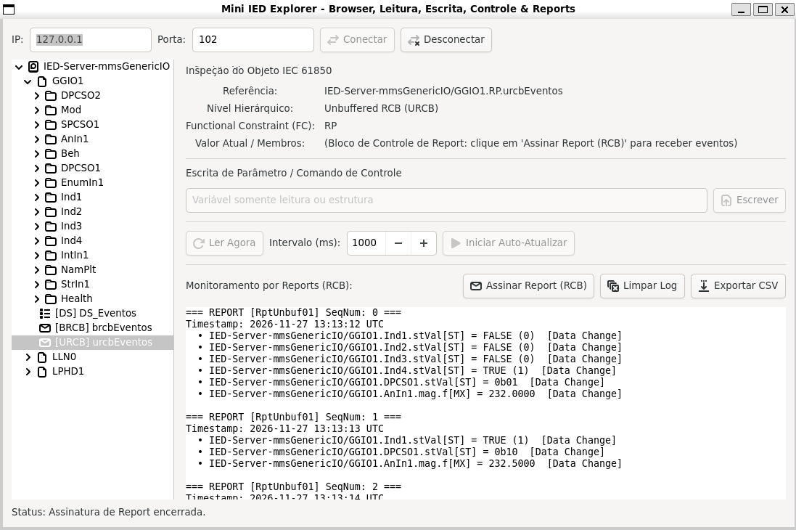

# IED Explorer

Escrito em linguagem C com interface gráfica GTK4



O arquivo "main.c" contém o código-fonte completo em C utilizando GTK 4 e libiec61850 para navegação na árvore do IED, 
leitura assíncrona com auto-atualização e o painel de escrita habilitado automaticamente para variáveis editáveis 
(SP, CF, DC, SV, SE e SG) com tipos MMS primitivos

## Dependências:

- Para instalar as dependências:

```
$ sudo apt update
$ sudo apt install -y build-essential cmake pkg-config libgtk-4-dev adwaita-icon-theme
```

- Clonar o repositório da libiec61850:

```
$ git clone https://github.com/mz-automation/libiec61850.git
```

### O que cada pacote faz:

- build-essential: Instala o compilador gcc, o make e as bibliotecas padrão da linguagem C.
- cmake: Necessário caso você precise recompilar a libiec61850.a do zero.
- pkg-config: Localiza automaticamente os caminhos do GTK4 para o Makefile.
- libgtk-4-dev: Instala o GTK4, a GLib e todos os arquivos .h necessários para compilar.
- adwaita-icon-theme: Garante que os ícones vetoriais da árvore e dos botões apareçam corretamente.


### Para Máquina de Produção / Usuário Final (Apenas Executar)

Se você já gerou o arquivo bin/mini_ied_explorer e quer copiá-lo para outro computador com 
Ubuntu/Debian apenas para rodar o programa (sem código-fonte), a instalação é bem mais leve:

```
$ sudo apt update
$ sudo apt install -y libgtk-4-1 adwaita-icon-theme
```

### Para saber todas as dependências do binário:

```
$ ldd ./bin/mini_ied_explorer
```

## Antes de compilar:
Edite o arquivo "Makefile" colocando na variável "IEC_DIR" o caminho onde foi clonada
a biblioteca "libiec61850.

Ex:

IEC_DIR = /home/desenvolvimento/libiec61850-1.6.2.1

## Para compilar:

```
~/IED Explorer$ make
```

## Para "limpar" a compilação:

```
~/IED Explorer$ make clean
```

O binário executável, será criado na pasta: /bin

## Para executar:

```
~/IED Explorer/bin$ sudo ./mini_ied_explorer
```

## Enviando um comando para o IED

Na janela do programa, siga esta sequência:

1. Conectar: Confirme o IP 127.0.0.1 e a porta (102 ou 10200) e clique em Conectar.

2. Navegar na árvore: Expanda GenericIO → GGIO1.

3. Testar Comando Direct Operate (SPCSO1):

- Expanda SPCSO1 e clique em Oper[CO] (ou clique diretamente no nó SPCSO1).
- O campo de escrita será habilitado automaticamente. Digite 1 (ou true) e clique em Escrever / Comandar.
- Clique em stVal[ST] dentro de SPCSO1 para confirmar que o valor mudou para TRUE (1).

4. Testar Comando SBO (DPCSO2):
	
- Expanda DPCSO2 e selecione Oper[CO] (ou o próprio DPCSO2).
- Digite 1 e clique em Escrever / Comandar (o cliente executará automaticamente o Select e depois o Operate).
- Verifique stVal[ST] dentro de DPCSO2: o estado mudará de 0b01 (Aberto/OFF) para 0b10 (Fechado/ON).
